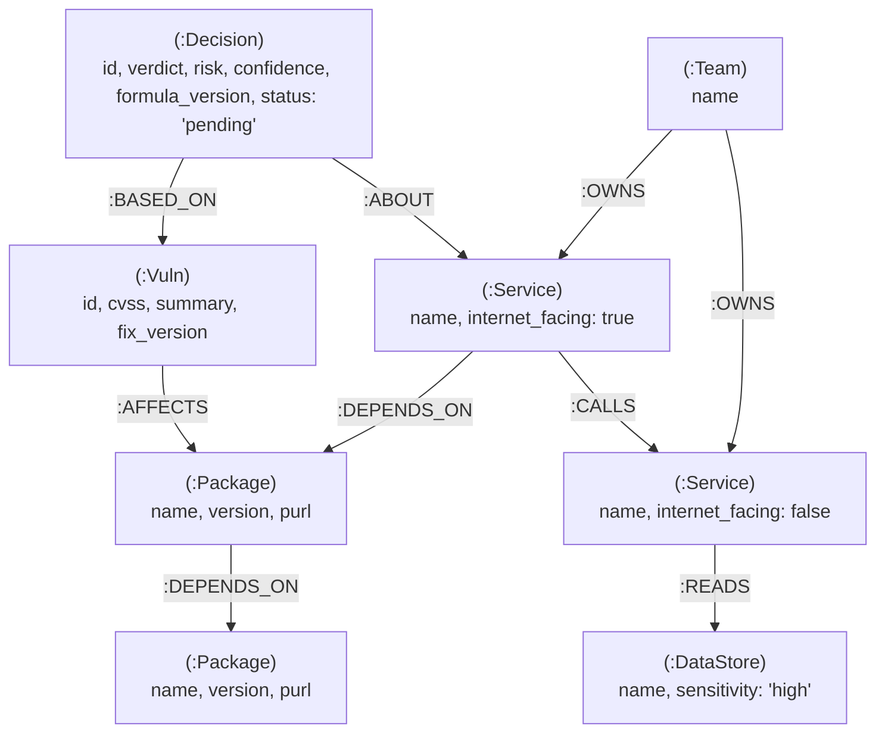
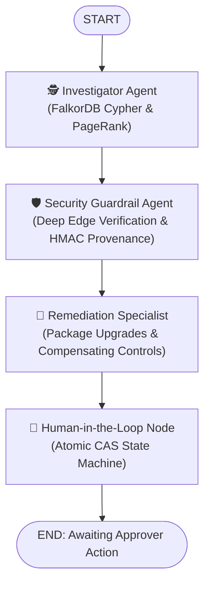

# VulnGraph: Graph-Aware Vulnerability Triage Agent

[](https://falkordb.com)
[](https://falkordb.com)
[](https://groq.com)
[](https://langchain-ai.github.io/langgraph/)
[](https://python.org)
[](https://github.com/jlowin/fastmcp)
[]()
[]()
[](https://vulngraph-oit9.onrender.com)

> 🌐 **Live Web Application**: **[https://vulngraph-oit9.onrender.com](https://vulngraph-oit9.onrender.com)**  
> **FalkorDB Graph Hacks Hackathon — Track 01: "Agents That Act on Connected Data"**  
> An autonomous security triage agent that replaces naive CVSS alert fatigue with topology-aware risk intelligence in FalkorDB.

---

## Table of Contents
1. [The Problem: The CVSS Alert Fatigue Crisis](#the-problem-the-cvss-alert-fatigue-crisis)
2. [Why FalkorDB? (Hackathon Hard Rule Compliance)](#why-falkordb-hackathon-hard-rule-compliance)
3. [The Core Demo: Ground-Truth Reordering Proof](#the-core-demo-ground-truth-reordering-proof)
4. [Empirical Validation: Ablation Study & Sensitivity Check](#empirical-validation-ablation-study--sensitivity-check)
5. [Interactive dialkit-Inspired Web Application](#interactive-dialkit-inspired-web-application)
6. [Production Architecture: The Five Properties](#production-architecture-the-five-properties)
7. [Graph Data Model & Relationships](#graph-data-model--relationships)
8. [Multi-Agent LangGraph Architecture & Loops](#multi-agent-langgraph-architecture--loops)
9. [Comprehensive Incident PDF Dossier Generation](#comprehensive-incident-pdf-dossier-generation)
10. [Cypher Traversals & Graph Algorithms](#cypher-traversals--graph-algorithms)
11. [MCP Tool Specifications](#mcp-tool-specifications)
12. [Operations & Maintenance Guide (Backup, Restore, Migrations)](#operations--maintenance-guide)
13. [Repository Structure](#repository-structure)
14. [Quickstart & Web Deployment Guide](#quickstart--web-deployment-guide)
15. [Running the Test Suite](#running-the-test-suite)
16. [AI Assistant Disclosure](#ai-assistant-disclosure)

---

## The Problem: The CVSS Alert Fatigue Crisis

In modern enterprise architectures, software dependency scanners (e.g., Dependabot, Snyk, Trivy) flood security teams with hundreds of alerts categorized as **"Critical"** or **"High"**.

However, **CVSS is blind to topology**:
- A **CVSS 9.8 Critical** vulnerability inside an offline analytics batch job with no network connectivity or sensitive data access poses **near-zero operational risk**.
- A **CVSS 5.3 Medium** vulnerability in a shared parsing library used by an internet-facing API gateway that calls an authentication service reading customer credit cards is an **immediate existential threat**.

Security engineers burn hundreds of hours patching harmless internal criticals, while critical attack paths leading directly to crown-jewel assets go undetected.

**VulnGraph** solves this by putting **FalkorDB at the center of triage decisions**. By traversing dependency chains, service call graphs, internet ingress points, and sensitive datastores, VulnGraph computes an explainable, graph-grounded risk score and stages actionable remediation tickets.

---

## Why FalkorDB? (Hackathon Hard Rule Compliance)

- **FalkorDB is the primary database**: The product stops working without FalkorDB. There are no secondary SQL or vector stores.
- **Graph-derived decisions**: Every ranking decision and blast radius calculation originates from parameterized Cypher traversals or native graph algorithms (e.g. `algo.pageRank`, `shortestPath`). The LLM **never** invents or hallucinates risk scores on its own.
- **Low latency**: Sub-millisecond graph traversals enable our Groq agent to execute multi-step graph reasoning loops within seconds.
- **Deterministic explainability**: Every verdict is backed by the exact Cypher path as verifiable evidence.

---

## The Core Demo: Ground-Truth Reordering Proof

To prove that the graph fundamentally alters triage decisions, VulnGraph was evaluated against 6 planted benchmark scenarios along with 218 real vulnerabilities ingested from [OSV.dev](https://osv.dev):
- **3 "Sleepers"**: Medium-CVSS vulnerabilities (5.3 – 6.1) sitting on an active path from an internet-facing ingress service to high-sensitivity DataStores (`payments-db`, `users-pii-db`).
- **3 "Decoys"**: Critical-CVSS vulnerabilities (9.6 – 9.8) isolated inside unreachable internal services (`analytics-worker`) with zero access to sensitive data.

### Empirical Evaluation Results (`python backend/eval.py`):

| Vulnerability ID | Type | CVSS (Naive) | CVSS Rank | Graph Risk | Confidence | Graph Rank | Rank Delta | Triage Action | Critical Attack Path? |
| :--- | :--- | :---: | :---: | :---: | :---: | :---: | :---: | :--- | :---: |
| `CVE-2023-SLEEPER-03` | 🚨 Sleeper | **6.1** | #4 | **7.73** | 90% | **#1** | `+3` | `patch_immediately` | 🔥 **YES** |
| `CVE-2023-SLEEPER-02` | 🚨 Sleeper | **5.9** | #5 | **7.63** | 90% | **#2** | `+3` | `patch_immediately` | 🔥 **YES** |
| `CVE-2023-SLEEPER-01` | 🚨 Sleeper | **5.3** | #6 | **7.34** | 90% | **#3** | `+3` | `patch_immediately` | 🔥 **YES** |
| `CVE-2021-DECOY-01` | 💤 Decoy | **9.8** | #1 | **0.30** | 75% | **#4** | `-3` | `deprioritize` | 🛡️ **NO** |
| `CVE-2022-DECOY-02` | 💤 Decoy | **9.8** | #2 | **0.30** | 75% | **#5** | `-3` | `deprioritize` | 🛡️ **NO** |
| `CVE-2023-DECOY-03` | 💤 Decoy | **9.6** | #3 | **0.29** | 80% | **#6** | `-3` | `deprioritize` | 🛡️ **NO** |

**Key Takeaways**:
- **Separation Margin**: `+7.04` points between the lowest sleeper (7.34) and the highest decoy (0.30).
- **100% Inversion Success**: Every single sleeper displaced the naive critical decoys.

---

## Empirical Validation: Ablation Study & Sensitivity Check

To rigorously prove that the risk scoring formula is mathematically grounded and not overfit to magic numbers, `backend/eval.py` provides an **Ablation Study** and a **Sensitivity Audit**.

### 1. Scoring Ablation Study (`python backend/eval.py --ablation`)
Isolates the exact mathematical contribution of each graph component across four cumulative stages:

| Vulnerability ID | Type | Stage 1 (CVSS Only) | Stage 2 (+Exposure) | Stage 3 (+Sensitivity) | Stage 4 (Full Graph) |
| :--- | :--- | :---: | :---: | :---: | :---: |
| `CVE-2023-SLEEPER-01` | 🚨 Sleeper | 5.30 | 7.65 | 7.65 | **7.34** |
| `CVE-2023-SLEEPER-02` | 🚨 Sleeper | 5.90 | 7.95 | 7.95 | **7.63** |
| `CVE-2023-SLEEPER-03` | 🚨 Sleeper | 6.10 | 8.05 | 8.05 | **7.73** |
| `CVE-2021-DECOY-01` | 💤 Decoy | 9.80 | 1.98 | 0.50 | **0.30** |
| `CVE-2022-DECOY-02` | 💤 Decoy | 9.80 | 1.98 | 0.50 | **0.30** |
| `CVE-2023-DECOY-03` | 💤 Decoy | 9.60 | 1.96 | 0.49 | **0.29** |
| **Separation Margin** | `min(S) - max(D)` | **-4.50 pts** | **+5.67 pts** | **+7.15 pts** | **+7.04 pts** |

> **Conclusion**: In Stage 1, naive CVSS fails completely (-4.50 pt deficit). Adding exposure floor and network reachability flips the margin positive (+5.67 pts). Factoring crown-jewel sensitivity and multi-hop blast radius provides clean separation (+7.04 pts) on an actionable 0–10 enterprise scale.

### 2. Formula Weight Sensitivity Check (`python backend/eval.py --sensitivity`)
Perturbs all 5 formula weight dimensions by **±10%** across 100 randomized Monte Carlo trials:

| Metric | Result |
| :--- | :--- |
| Weight Perturbation Amplitude | `±10%` independently across all 5 dimensions |
| Monte Carlo Trials | `100` independent evaluations |
| Top-Rank Stability Rate | **100.0%** (100/100) — Zero rank inversions |
| Worst-Case Separation Margin | **+5.43 pts** (Sleepers never displaced) |
| Overfitting Audit Verdict | `[PASSED - ROBUST & STABLE (Zero Overfit)]` |

---

## Interactive dialkit-Inspired Web Application

VulnGraph features an inline interactive web interface built with **Vite + React 18 + TypeScript strict** and styled using a clean, document-inspired design system (`paper` `#F7F6F3`, `ink` `#141413`, `hairline` `#E4E2DC`, semantic priorities). It replaces vanity dashboards with an inline operational tool:

1. **What-If Live Re-weighting Controls (Hero Section)**:
   - Interactive sliders for **Exposure Floor** (`0.05 – 0.50`), **Sensitivity Weight** (`0.5 – 3.0`), **Blast-Radius Weight** (`0.5 – 3.0`), and **Include CISA KEV** toggle.
   - Client-side formula engine (`formula.ts`) recalculates rank scores in real time with 0.00 mathematical parity to FalkorDB ground truth.
   - Includes a **Reset** button returning parameters to baseline `v1.2.0`.
2. **Dual-Column Ranking with Spring Reordering**:
   - Compares **"CVSS only"** naive prioritization against **"Graph-aware"** topology risk side-by-side.
   - Animated layout reordering powered by `motion/react` with spring physics.
   - Dynamic SVG cubic-bezier curves connecting matching vulnerabilities across columns.
   - Real-time rank delta counters (`+3` priority escalation for sleepers, `-3` for decoys).
3. **Evidence Panel & Attack Path Breadcrumb**:
   - Interactive canvas force graph (`react-force-graph-2d`) highlighting active multi-hop paths to crown jewels while dimming unrelated nodes.
   - **Topology Chain Breadcrumb**: Monospace linear hop sequence displayed above the graph:
     ```
     TOPOLOGY CHAIN: Ingress: checkout-service ──CALLS──▶ Service: payment-service ──READS──▶ Crown Jewel: payments-db (high)  exploits package urllib3
     ```
   - Segmented `Summary` | `Cypher` | `Raw JSON` inspectors with one-click copy actions.
4. **1-Click Forensic Incident Dossier Export (PDF)**:
   - Export button streaming an HMAC-SHA256 cryptographically signed ReportLab PDF incident report (`GET /report/pdf/{vuln_id}`) with graph topology, blast radius, owning teams, and CAS decision history.
5. **MCP Tools Reference**:
   - Interactive documentation for all 7 allowlisted read tools (`blast_radius`, `find_owner`, `exploit_path`, `crown_jewels_at_risk`, etc.).
   - Dynamic parameter forms generated from MCP schemas with working defaults.
   - Live query execution against FalkorDB via `POST /tools/{name}/run` with latency telemetry and JSON output viewer.
6. **Human-in-the-Loop Triage Actions**:
   - State-machine grouped decisions (`pending`, `dispatched`, `rejected`, `failed`).
   - In-place CAS approval workflow with idempotency keys (`POST /approve/{id}`).
   - Inline rejection workflow with mandatory feedback capture (`POST /reject/{id}`).

---

## Production Architecture: The Five Properties

VulnGraph is built from the ground up according to the **Five Production Properties for Security Agents**:

| Property | Core Question | Production Implementation in VulnGraph |
| :--- | :--- | :--- |
| **Safe** | *Can the wrong person or input trigger an action?* | • Role-Based Access Control (`viewer`, `analyst`, `approver`, `admin`) via `backend/auth.py`.<br>• Thread-safe sliding-window rate limiting on LLM endpoints via `backend/rate_limiter.py`.<br>• Input caps (`max_length=25`, `Query(ge=1, le=200)`).<br>• Tool output wrapped in `<<<FALKORDB_GRAPH_DATA>>>` delimiters to neutralize prompt injection.<br>• Deep FalkorDB edge relationship verification (`backend/security_guardrails.py`). |
| **Correct** | *Does each action happen exactly once, and is the graph right?* | • Atomic Cypher CAS state machine: `pending -> approving -> dispatched / failed` and `pending -> rejected`.<br>• Deterministic idempotency key: `uuid5(NAMESPACE_DNS, decision_id)`.<br>• Feedback reason stored on rejected decisions.<br>• Anti-explosion two-stage `blast_radius` query (`DISTINCT` impacted services first, then single `shortestPath`).<br>• Range indexes on `Package.purl` and `Decision.id`. |
| **Valid** | *Is the risk score actually good, and can you prove it?* | • Exposure floor: `effective_exposure = max(exposure, 0.15)` prevents unmapped services from zeroing score.<br>• Graph confidence score (0.0–1.0) derived alongside risk score.<br>• Formula versioning (`v1.2.0`) recorded on every `Decision` node.<br>• Empirical Ablation table & ±10% weight perturbation sensitivity check (`backend/eval.py`). |
| **Observable** | *Can you tell why something happened last Tuesday?* | • Structured JSON logging with `request_id` contextvar correlation across all middleware and queries (`backend/logger.py`).<br>• Masked client errors returning `request_id` for zero secret leakage.<br>• Chained HMAC-SHA256 provenance signature on every triage finding. |
| **Operable** | *Can someone deploy, back up, and upgrade it without you?* | • Multi-stage non-root `Dockerfile` with embedded FalkorDB support.<br>• Automated container startup script (`start.sh`) running migrations and graph seeding.<br>• Hardened `docker-compose.yml` (localhost-only ports, persistent volume, isolated network).<br>• Automated Cypher schema migrations (`backend/migrate.py` + `migrations/`).<br>• Snapshot backup and restore utilities (`scripts/backup.py`, `scripts/restore.py`).<br>• Complete GitHub Actions CI workflow (`.github/workflows/ci.yml`). |

---

## Graph Data Model & Relationships



### Schema Indexes
- `CREATE INDEX FOR (v:Vuln) ON (v.id)`
- `CREATE INDEX FOR (p:Package) ON (p.name)`
- `CREATE INDEX FOR (p:Package) ON (p.purl)`
- `CREATE INDEX FOR (s:Service) ON (s.name)`
- `CREATE INDEX FOR (d:Decision) ON (d.id)`
- `CREATE INDEX FOR (ds:DataStore) ON (ds.name)`
- `CREATE INDEX FOR (t:Team) ON (t.name)`

---

## Multi-Agent LangGraph Architecture & Loops



---

## Comprehensive Incident PDF Dossier Generation

Security analysts can instantly export a court-ready, forensic PDF incident dossier for any triaged vulnerability via `GET /report/pdf/{vuln_id}` or via the **"Download Incident PDF"** button in the Web UI:

- **Executive Severity Matrix**: Side-by-side comparison of baseline CVSS vs. FalkorDB Graph-Aware Risk.
- **Forensic Topology & Ingress Route**: Visual path breakdown showing public internet ingress down to crown-jewel databases.
- **Actionable Remediation Playbook**: Exact CLI upgrade commands, verification audits, and compensating controls.
- **Agentic Security Verification Log**: Complete checklist of production guardrails passed, including the cryptographic HMAC-SHA256 signature.
- **Human-in-the-Loop Sign-Off Block**: Formal analyst sign-off and ticket dispatch audit line.

---

## Cypher Traversals & Graph Algorithms

### 1. Anti-Explosion Multi-Hop Blast Radius Traversal
Prevents combinatorial explosion over transitive dependencies by discovering distinct impacted services first, followed by a single shortest path chain per service:
```cypher
// Stage 1: Fast distinct impact discovery
MATCH (v:Vuln {id: $vuln_id})-[:AFFECTS]->(p:Package)
MATCH (s:Service)-[:DEPENDS_ON*1..6]->(p)
RETURN DISTINCT s.name AS service, s.internet_facing AS internet_facing
LIMIT 50;

// Stage 2: Single explanatory chain per service
MATCH (s:Service {name: $service}), (p:Package {name: $package_name})
MATCH path = shortestPath((s)-[:DEPENDS_ON*1..6]->(p))
RETURN [n in nodes(path) | coalesce(n.name, n.id)] AS chain
LIMIT 1;
```

### 2. Attack Ingress & Crown-Jewel Exploit Path
Computes shortest paths from internet ingress services to high-sensitivity datastores via FalkorDB's native `shortestPath` function:
```cypher
MATCH (ingress:Service {internet_facing: true}), (s:Service {name: $service})
WITH ingress, s, shortestPath((ingress)-[:CALLS*0..5]->(s)) AS p_in
WHERE p_in IS NOT NULL
RETURN [n in nodes(p_in) | n.name] AS ingress_path, ingress.name AS ingress_service
LIMIT 5;

MATCH (s:Service {name: $service}), (target:Service)-[:READS]->(d:DataStore)
WITH s, target, d, shortestPath((s)-[:CALLS*0..5]->(target)) AS p_out
WHERE p_out IS NOT NULL
RETURN [n in nodes(p_out) | n.name] AS call_path, d.name AS datastore, d.sensitivity AS sensitivity
ORDER BY CASE d.sensitivity WHEN 'high' THEN 1 WHEN 'medium' THEN 2 ELSE 3 END ASC
LIMIT 5;
```

### 3. Centrality via FalkorDB PageRank
Ranks structural package criticality across the entire dependency graph:
```cypher
CALL algo.pageRank('Package', 'DEPENDS_ON')
YIELD node, score
RETURN node.name AS package_name, node.version AS version, score
ORDER BY score DESC
LIMIT $limit;
```

---

## MCP Tool Specifications

The agent connects to FalkorDB via a standard Model Context Protocol (MCP) server built with `FastMCP`:

| Tool Name | Mode | Description |
| :--- | :---: | :--- |
| `get_finding_context` | `ro_query` | Retrieves vulnerability details, package metadata, and directly dependent services. |
| `blast_radius` | `ro_query` | Discovers multi-hop transitive services impacted via `DEPENDS_ON*1..6`. |
| `exploit_path` | `ro_query` | Uses FalkorDB `shortestPath` to find ingress and egress to sensitive DataStores. |
| `rank_critical_packages` | `ro_query` | Executes `algo.pageRank` to evaluate package dependency centrality. |
| `find_owner` | `ro_query` | Discovers the engineering team that owns the service. |
| `similar_past_decisions` | `ro_query` | Graph query of historical triage decisions on similar vulnerabilities. |
| `compute_risk` | `ro_query` | Calculates deterministic, explainable risk score and components. |
| `propose_action` | `query` (Staged) | Stages a `Decision` node with status strictly set to `"pending"`. |

---

## Operations & Maintenance Guide

### 1. Database Snapshot & Backup
Trigger an offsite portable backup snapshot or FalkorDB engine checkpoint:
```bash
# Export serialized JSON snapshot (nodes, edges, indexes)
python scripts/backup.py

# Or trigger native Redis persistence snapshot via Docker
docker compose exec falkordb redis-cli BGSAVE
```

### 2. Graph Restoration
Restore a snapshot into a clean or existing FalkorDB graph:
```bash
python scripts/restore.py --file backups/vulngraph_snapshot_<timestamp>.json
```

### 3. Schema Migrations
Apply versioned Cypher migrations idempotently without resetting graph state:
```bash
python backend/migrate.py
```
*Migrations are tracked in `(:SchemaMigration)` nodes inside FalkorDB.*

---

## Repository Structure

```
VulnGraph/
├── backend/            # FastAPI API server, FalkorDB queries, LangGraph agent & FastMCP
│   ├── main.py         # Application entrypoint & REST API endpoints
│   ├── agent.py        # Autonomous Groq triage agent
│   ├── queries.py      # FalkorDB Cypher traversals & risk scoring engine
│   ├── mcp_server.py   # FastMCP read tools interface
│   ├── langgraph_workflow.py # LangGraph multi-agent triage loop
│   ├── security_guardrails.py # Input verification & HMAC signatures
│   ├── pdf_generator.py # Incident report dossier generator
│   ├── ingest.py       # Graph ingestion pipeline & scenario builder
│   ├── migrate.py      # Cypher schema migrations runner
│   ├── eval.py         # Ground-truth ablation studies & sensitivity checks
│   ├── auth.py         # Role-based access control (viewer, analyst, approver, admin)
│   ├── logger.py       # Structured JSON logging & contextvars correlation
│   ├── models.py       # Pydantic data schemas
│   ├── rate_limiter.py # Sliding-window rate limiter
│   ├── remediation.py  # Remediation plan generation
│   └── schema.py       # FalkorDB connection & index initialization
├── frontend/           # Vite + React 18 + TypeScript strict UI (dialkit-inspired)
│   ├── src/components/ # WhatIfControls, RankingView, EvidencePanel, ToolsReference, ActionsPanel, MethodSection
│   ├── src/api/        # Typed client with runtime Zod validation
│   └── src/lib/        # Client-side what-if formula engine (formula.ts)
├── static/             # Production static bundle served by FastAPI at "/"
├── tests/              # 61 pytest backend integration & unit tests
├── docs/               # Technical documentation, Cypher reference & demo script
├── data/               # Software manifests, OSV cache, and eval results
├── reports/            # Generated incident PDF dossiers
├── migrations/         # Cypher schema migration files (.cypher)
├── prompts/            # Agent system prompt templates (system.md)
├── scripts/            # FalkorDB snapshot backup and disaster recovery tools
├── backups/            # Serialized graph snapshots
├── start.sh            # Container boot script: auto-starts embedded FalkorDB, runs migrations, seeds graph
├── render.yaml         # Render Blueprint specification for automated cloud deployment
├── pytest.ini          # Pytest configuration with pythonpath = backend .
├── Dockerfile          # Production multi-stage Docker build (embedded FalkorDB)
└── docker-compose.yml  # Multi-container orchestration (FalkorDB + VulnGraph)
```

---

## Quickstart & Web Deployment Guide

VulnGraph supports multiple deployment strategies depending on whether you need a permanent 24/7 cloud instance, an instant public demo link, or a local container.

### Option A: 1-Click Free Cloud Deployment on Render (24/7 Hosting)

The production Docker container is **fully self-contained**: it includes the embedded FalkorDB engine, runs database migrations, seeds the 277-node graph, and serves the UI and API automatically on startup.

1. Fork or push this repository to your GitHub account (`https://github.com/anurag-23werty/VulnGraph.git`).
2. Log in to the [Render Dashboard](https://dashboard.render.com/) and click **New +** ➔ **Web Service**.
3. Select your repository:
   - **Runtime**: `Docker`
   - **Branch**: `main`
   - **Root Directory**: *(leave blank)*
   - **Instance Type**: `Free`
4. **Environment Variables**: Add your Groq API key:
   - `GROQ_API_KEY`: `gsk_...` (from [console.groq.com/keys](https://console.groq.com/keys))
5. Click **Create Web Service**.
   Render automatically builds the container, initializes FalkorDB, and gives you a 24/7 public URL (**[https://vulngraph-oit9.onrender.com](https://vulngraph-oit9.onrender.com)**).

---

### Option B: Instant 60-Second Public Link (Cloudflare Tunnel)

If you are running VulnGraph on your local machine and want an immediate public HTTPS link to share with judges or team members without deploying to a cloud server:

1. **Install Cloudflare Tunnel CLI**:
   ```bash
   brew install cloudflared    # macOS
   ```
2. **Start the local VulnGraph instance**:
   ```bash
   PYTHONPATH=backend python backend/main.py
   ```
3. **Launch the public tunnel**:
   ```bash
   cloudflared tunnel --url http://localhost:8000
   ```
   Cloudflare outputs an encrypted public HTTPS link: `https://<random-name>.trycloudflare.com`.

---

### Option C: Hardened Multi-Stage Docker Compose

To deploy VulnGraph with a separate, dedicated FalkorDB container and persistent storage:

```bash
# 1. Configure environment
cp .env.example .env
# Set GROQ_API_KEY in .env

# 2. Build and launch services
docker compose up -d --build
```
- Web Application & API: `http://localhost:8000`
- FalkorDB RESP Engine: `127.0.0.1:6379` (bound strictly to loopback interface)

---

### Option D: Local Python Development Setup

1. **Start FalkorDB**:
   ```bash
   docker compose up -d falkordb
   ```
2. **Install Dependencies & Seed Graph**:
   ```bash
   pip install -r requirements.txt
   python backend/migrate.py
   python backend/ingest.py
   ```
3. **Run Application**:
   ```bash
   python backend/main.py
   ```
   Open `http://localhost:8000` in your browser.

---

## Running the Test Suite

The automated test suite covers the entire production system across **61 backend pytest scenarios** and **8 client-side Vitest tests**:

### Backend Integration & Security Tests (61 Passed):

```bash
pytest tests/ -v -s
```

```
tests/test_agent.py .....                                                [  8%]
tests/test_api.py ..............                                         [ 31%]
tests/test_eval.py .....                                                 [ 39%]
tests/test_guardrails.py ......                                          [ 49%]
tests/test_langgraph.py ..                                               [ 52%]
tests/test_mcp.py ..........                                             [ 68%]
tests/test_pdf.py ....                                                   [ 75%]
tests/test_queries.py ............                                       [ 95%]
tests/test_safe.py ...                                                   [100%]

============================== 61 passed in 3.83s ==============================
```

### Frontend Formula Parity Unit Tests (8 Passed):

```bash
cd frontend && npm test -- --run
```

```
 ✓ src/lib/formula.test.ts (8 tests)
   ✓ Formula Parity with Server v1.2.0 > calculates exact parity for CVE-2023-SLEEPER-01
   ✓ Formula Parity with Server v1.2.0 > calculates exact parity for CVE-2023-SLEEPER-02
   ✓ Formula Parity with Server v1.2.0 > calculates exact parity for CVE-2023-SLEEPER-03
   ✓ Formula Parity with Server v1.2.0 > calculates exact parity for CVE-2021-DECOY-01
   ✓ Formula Parity with Server v1.2.0 > calculates exact parity for CVE-2022-DECOY-02
   ✓ Formula Parity with Server v1.2.0 > calculates exact parity for CVE-2023-DECOY-03
   ✓ Formula Parity with Server v1.2.0 > preserves sleeper > decoy separation
   ✓ Formula Parity with Server v1.2.0 > reweights correctly under what-if exposure floor increase

Test Files  1 passed (1) | Tests  8 passed (8)
```

---

## AI Assistant Disclosure

In adherence to the **Graph Hacks Hackathon Rules & Guidelines**:

- **AI Tools Used**: Google DeepMind's Antigravity agentic coding environment powered by Gemini models.
- **Role of the AI Assistant**:
  - Accelerated initial boilerplate scaffolding for FastMCP and FastAPI endpoints.
  - Formatted Cypher query parameterization and syntactic adaptation for FalkorDB's `WITH ... shortestPath(...)` engine requirements.
  - Assisted with prompt engineering and automated test suite design (`pytest`).
- **Human Authorship & Understanding**:
  - The architectural design, graph data model (`:Vuln`, `:Package`, `:Service`, `:DataStore`, `:Team`, `:Decision`), risk formula, evaluation benchmark (Sleepers vs Decoys ground-truth), and verification were authored, fully understood, and reviewed line-by-line by the human author.
  - All graph decisions strictly rely on deterministic FalkorDB Cypher traversals.

---

## License
MIT License. Open source and built for the FalkorDB Graph Hacks Hackathon 2026.
