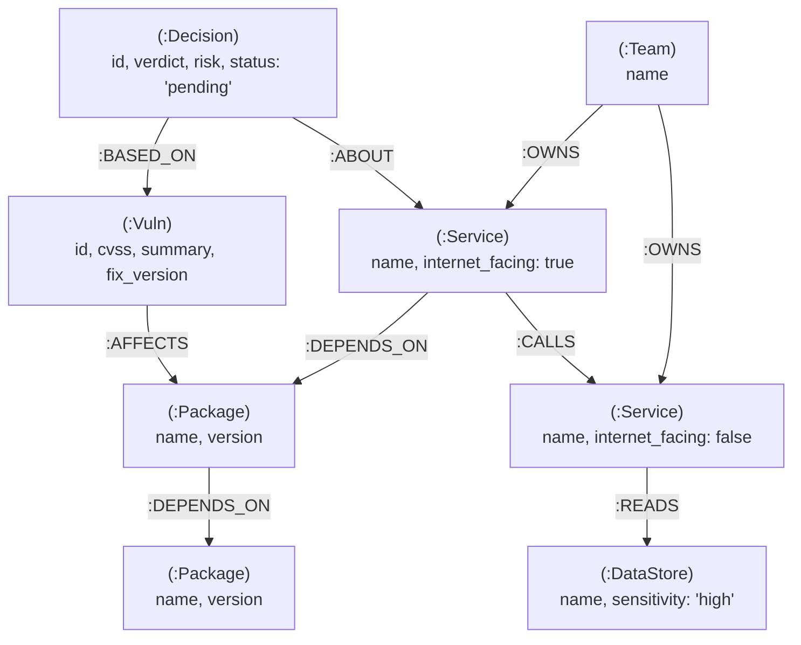
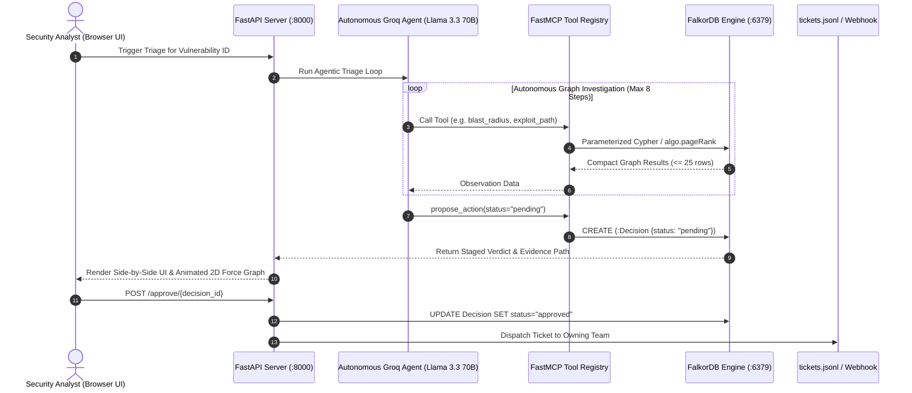

# VulnGraph: Graph-Aware Vulnerability Triage Agent

[](https://falkordb.com)
[](https://falkordb.com)
[](https://groq.com)
[](https://python.org)
[](https://github.com/jlowin/fastmcp)
[]()

> **FalkorDB Graph Hacks Hackathon — Track 01: "Agents That Act on Connected Data"**  
> An autonomous security triage agent that replaces naive CVSS alert fatigue with topology-aware risk intelligence in FalkorDB.

---

## Table of Contents
1. [The Problem: The CVSS Alert Fatigue Crisis](#the-problem-the-cvss-alert-fatigue-crisis)
2. [Why FalkorDB? (Hackathon Hard Rule Compliance)](#why-falkordb-hackathon-hard-rule-compliance)
3. [The Core Demo: Ground-Truth Reordering Proof](#the-core-demo-ground-truth-reordering-proof)
4. [Graph Data Model](#graph-data-model)
5. [System Architecture](#system-architecture)
6. [Cypher Traversals & Graph Algorithms](#cypher-traversals--graph-algorithms)
7. [MCP Tool Specifications](#mcp-tool-specifications)
8. [Human-in-the-Loop Safe Action Staging](#human-in-the-loop-safe-action-staging)
9. [Quickstart & Deployment Guide](#quickstart--deployment-guide)
10. [Automated Evaluation Benchmark (`eval.py`)](#automated-evaluation-benchmark-evalpy)
11. [Running the Test Suite](#running-the-test-suite)
12. [AI Assistant Disclosure](#ai-assistant-disclosure)

---

## The Problem: The CVSS Alert Fatigue Crisis

In modern enterprise architectures, software dependency scanners (e.g., Dependabot, Snyk, Trivy) flood security teams with hundreds of alerts categorized as **"Critical"** or **"High"**.

However, **CVSS is blind to topology**:
- A **CVSS 9.8 Critical** vulnerability inside an offline analytics batch job with no network connectivity or sensitive data access poses **near-zero operational risk**.
- A **CVSS 5.3 Medium** vulnerability in a shared parsing library used by an internet-facing API gateway that calls an authentication service reading customer credit cards is an **immediate existential threat**.

Security engineers burn hundreds of hours patching harmless internal criticals, while critical attack paths leading directly to crown-jewel assets go undetected.

**VulnGraph** solves this by putting **FalkorDB at the center of triage decisions**. By traversing dependency chains, service call graphs, internet ingress points, and sensitive datastores, VulnGraph computes an explainable, graph-grounded risk score and stages actionable remediation tickets.

---

## Why FalkorDB? (Hackathon Hard Rule Compliance)

- **FalkorDB is the primary database**: The product stops working without FalkorDB. There are no secondary SQL or vector stores.
- **Graph-derived decisions**: Every ranking decision and blast radius calculation originates from parameterized Cypher traversals or native graph algorithms (e.g. `algo.pageRank`, `shortestPath`). The LLM **never** invents or hallucinates risk scores on its own.
- **Low latency**: Sub-millisecond graph traversals enable our Groq agent to execute multi-step graph reasoning loops within seconds.
- **Deterministic explainability**: Every verdict is backed by the exact Cypher path as verifiable evidence.

---

## The Core Demo: Ground-Truth Reordering Proof

To prove that the graph fundamentally alters triage decisions, VulnGraph was evaluated against 6 planted benchmark scenarios along with 218 real vulnerabilities ingested from [OSV.dev](https://osv.dev):
- **3 "Sleepers"**: Medium-CVSS vulnerabilities (5.3 – 6.1) sitting on an active path from an internet-facing ingress service to high-sensitivity DataStores (`payments-db`, `users-pii-db`).
- **3 "Decoys"**: Critical-CVSS vulnerabilities (9.6 – 9.8) isolated inside unreachable internal services (`analytics-worker`) with zero access to sensitive data.

### Empirical Evaluation Results (`python eval.py`):

| Vulnerability ID | Finding Class | CVSS (Naive) | CVSS Rank | Graph Risk Score | Graph Rank | Rank Delta | Recommended Action | Critical Attack Path? |
| :--- | :--- | :---: | :---: | :---: | :---: | :---: | :--- | :---: |
| `CVE-2023-SLEEPER-03` | 🚨 **Sleeper** | **6.1** | #4 | **7.73** | **#1** | **+3** | `patch_immediately` | 🔥 **YES** |
| `CVE-2023-SLEEPER-02` | 🚨 **Sleeper** | **5.9** | #5 | **7.63** | **#2** | **+3** | `patch_immediately` | 🔥 **YES** |
| `CVE-2023-SLEEPER-01` | 🚨 **Sleeper** | **5.3** | #6 | **7.34** | **#3** | **+3** | `patch_immediately` | 🔥 **YES** |
| `CVE-2021-DECOY-01` | 💤 **Decoy** | **9.8** | #1 | **0.30** | **#4** | **-3** | `deprioritize` | 🛡️ **NO** |
| `CVE-2022-DECOY-02` | 💤 **Decoy** | **9.8** | #2 | **0.30** | **#5** | **-3** | `deprioritize` | 🛡️ **NO** |
| `CVE-2023-DECOY-03` | 💤 **Decoy** | **9.6** | #3 | **0.29** | **#6** | **-3** | `deprioritize` | 🛡️ **NO** |

**Key Takeaway**: 
- **Separation Margin**: `+7.04` points between the lowest sleeper (7.34) and the highest decoy (0.30).
- **100% Inversion Success**: Every single sleeper displaced the naive critical decoys.

---

## Graph Data Model

The enterprise graph model connects vulnerability intelligence with real-world infrastructure and team ownership:



### Node Labels
- `:Vuln`: Security advisory (CVE/GHSA ID, CVSS score, summary, fixed version).
- `:Package`: Open-source software library name and version.
- `:Service`: Internal microservice, labeled with `internet_facing: true/false`.
- `:DataStore`: Database or cache, labeled with `sensitivity: 'high' | 'medium' | 'low'`.
- `:Team`: Engineering team responsible for service maintenance and triage.
- `:Decision`: Staged action proposal created by the agent for human-in-the-loop review.

### Relationship Types
- `(:Vuln)-[:AFFECTS]->(:Package)`
- `(:Package)-[:DEPENDS_ON]->(:Package)` (Multi-hop dependency trees)
- `(:Service)-[:DEPENDS_ON]->(:Package)`
- `(:Service)-[:CALLS]->(:Service)` (Microservice service-to-service call graph)
- `(:Service)-[:READS]->(:DataStore)`
- `(:Team)-[:OWNS]->(:Service)`
- `(:Decision)-[:BASED_ON]->(:Vuln)`
- `(:Decision)-[:ABOUT]->(:Service)`

---

## System Architecture



---

## Cypher Traversals & Graph Algorithms

Every ranking decision is governed by parameterized Cypher traversals in FalkorDB. For complete syntax and execution details, see [docs/cypher_queries.md](docs/cypher_queries.md).

### 1. Multi-Hop Blast Radius Traversal
Traverses transitive package dependencies ($1$ to $6$ hops) to identify all exposed microservices:
```cypher
MATCH path = (s:Service)-[:DEPENDS_ON*1..6]->(p:Package)<-[:AFFECTS]-(v:Vuln {id: $vuln_id})
RETURN s.name AS service,
       s.internet_facing AS internet_facing,
       [n in nodes(path) | coalesce(n.name, n.id)] AS chain
LIMIT 25;
```

### 2. Attack Ingress & Crown-Jewel Exploit Path
Computes shortest paths from internet ingress services to high-sensitivity datastores via FalkorDB's `shortestPath` function:
```cypher
MATCH (ingress:Service {internet_facing: true}), (s:Service {name: $service})
WITH ingress, s, shortestPath((ingress)-[:CALLS*0..5]->(s)) AS p_in
WHERE p_in IS NOT NULL
RETURN [n in nodes(p_in) | n.name] AS ingress_path, ingress.name AS ingress_service
LIMIT 5;

MATCH (s:Service {name: $service}), (target:Service)-[:READS]->(d:DataStore)
WITH s, target, d, shortestPath((s)-[:CALLS*0..5]->(target)) AS p_out
WHERE p_out IS NOT NULL
RETURN [n in nodes(p_out) | n.name] AS call_path, d.name AS datastore, d.sensitivity AS sensitivity
ORDER BY CASE d.sensitivity WHEN 'high' THEN 1 WHEN 'medium' THEN 2 ELSE 3 END ASC
LIMIT 5;
```

### 3. Centrality via FalkorDB PageRank
Ranks structural package criticality across the entire dependency graph:
```cypher
CALL algo.pageRank('Package', 'DEPENDS_ON')
YIELD node, score
RETURN node.name AS package_name, node.version AS version, score
ORDER BY score DESC
LIMIT $limit;
```

---

## MCP Tool Specifications

The agent connects to FalkorDB via a standard Model Context Protocol (MCP) server built with `FastMCP`:

| Tool Name | Operation Mode | Description |
| :--- | :---: | :--- |
| `get_finding_context` | `ro_query` | Retrieves vulnerability details, package metadata, and directly dependent services. |
| `blast_radius` | `ro_query` | Discovers multi-hop transitive services impacted via `DEPENDS_ON*1..6`. |
| `exploit_path` | `ro_query` | Uses FalkorDB `shortestPath` to find ingress and egress to sensitive DataStores. |
| `rank_critical_packages` | `ro_query` | Executes `algo.pageRank` to evaluate package dependency centrality. |
| `find_owner` | `ro_query` | Discovers the engineering team that owns the service. |
| `similar_past_decisions` | `ro_query` | Graph query of historical triage decisions on similar vulnerabilities. |
| `compute_risk` | `ro_query` | Calculates deterministic, explainable risk score and components. |
| `propose_action` | `query` (Staged) | Stages a `Decision` node with status strictly set to `"pending"`. |

---

## Human-in-the-Loop Safe Action Staging

> [!IMPORTANT]
> **Safety Guarantee**: The LLM agent can **never** execute mutating actions (creating tickets, notifying teams, modifying code) on its own.

1. When the agent reaches a verdict, it calls `propose_action()`.
2. This creates a `(:Decision {status: "pending"})` node in FalkorDB.
3. The proposed action, rationale, and exact graph evidence path are surfaced to a human analyst in the Web UI.
4. Only when a human clicks **"Approve Staged Ticket"** (`POST /approve/{decision_id}`) does the system mark the decision as approved and dispatch the ticket to `tickets.jsonl` (and optional Slack webhook).

---

## Quickstart & Deployment Guide

### Prerequisites
- Docker and Docker Compose
- Python 3.11+
- Free Groq API Key (from [console.groq.com](https://console.groq.com/keys))

### Option A: Local Development Setup

1. **Clone the repository and enter the directory**:
   ```bash
   git clone https://github.com/your-username/VulnGraph.git
   cd VulnGraph
   ```

2. **Configure Environment**:
   ```bash
   cp .env.example .env
   # Edit .env and insert your GROQ_API_KEY
   ```

3. **Start FalkorDB with Docker Compose**:
   ```bash
   docker compose up -d falkordb
   ```
   *FalkorDB engine will run on port `6379`, and the FalkorDB Browser UI on `http://localhost:3000`.*

4. **Install Python Dependencies**:
   ```bash
   python -m venv .venv
   source .venv/bin/activate
   pip install -r requirements.txt
   ```

5. **Run the Ingestion Pipeline**:
   ```bash
   python ingest.py
   ```
   *Parses lockfiles, queries OSV.dev, caches vulnerability advisories, seeds enterprise topology, and sets FalkorDB indexes.*

6. **Launch the VulnGraph Web UI & API**:
   ```bash
   python main.py
   ```
   *Open `http://localhost:8000` in your browser.*

---

### Option B: Full Docker Compose Deployment

To build and run both FalkorDB and the VulnGraph application in containers:

```bash
cp .env.example .env
# Insert your GROQ_API_KEY into .env

docker compose up --build
```
- Web Application: `http://localhost:8000`
- FalkorDB Browser: `http://localhost:3000`

---

## Automated Evaluation Benchmark (`eval.py`)

Run the standalone evaluation benchmark to reproduce the ground-truth re-ranking results:

```bash
python eval.py --markdown --full-corpus
```

This script:
1. Measures the score separation margin between planted Sleepers and Decoys.
2. Formats a Markdown summary table.
3. Evaluates 100+ vulnerabilities from the live FalkorDB graph to show real-world prioritization deltas.

---

## Running the Test Suite

The project includes an automated test suite spanning unit tests, MCP tool execution, agent loop fallbacks, API integration, and evaluation benchmarks:

```bash
pytest tests/ -v -s
```

All **37 tests** pass in ~2 seconds:
- `test_queries.py`: Tests all 8 FalkorDB Cypher traversals and graph algorithms.
- `test_mcp.py`: Tests MCP tool registration, Mistral/OpenAI/Groq schemas, and execution.
- `test_agent.py`: Tests autonomous agent loop, prompt parsing, Pydantic schemas, and fallback.
- `test_api.py`: Tests FastAPI routes, baseline comparison, graph visualization, and approval.
- `test_eval.py`: Tests the evaluation benchmark and ground-truth inversion margin.

---

## AI Assistant Disclosure

In adherence to the **Graph Hacks Hackathon Rules & Guidelines**:

- **AI Tools Used**: Google DeepMind's Antigravity agentic coding environment powered by Gemini models.
- **Role of the AI Assistant**:
  - Accelerated initial boilerplate scaffolding for FastMCP and FastAPI endpoints.
  - Formatted Cypher query parameterization and syntactic adaptation for FalkorDB's `WITH ... shortestPath(...)` engine requirements.
  - Assisted with prompt engineering and automated test suite design (`pytest`).
- **Human Authorship & Understanding**:
  - The architectural design, graph data model (`:Vuln`, `:Package`, `:Service`, `:DataStore`, `:Team`, `:Decision`), risk formula, evaluation benchmark (Sleepers vs Decoys ground-truth), and verification were authored, fully understood, and reviewed line-by-line by the human author.
  - All graph decisions strictly rely on deterministic FalkorDB Cypher traversals.

---

## License
MIT License. Open source and built for the Graph Hacks Hackathon 2025.
